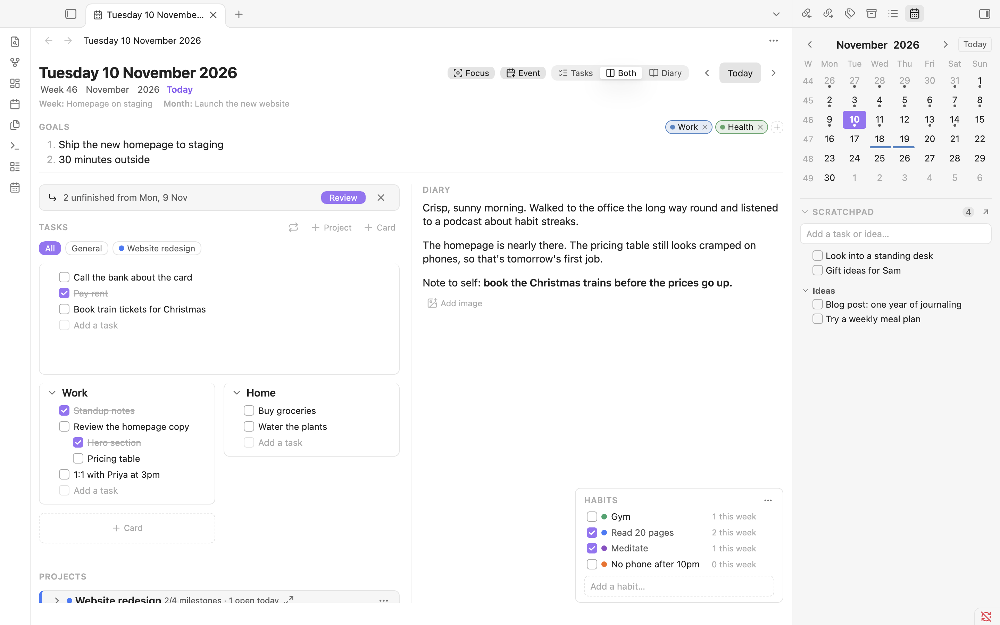
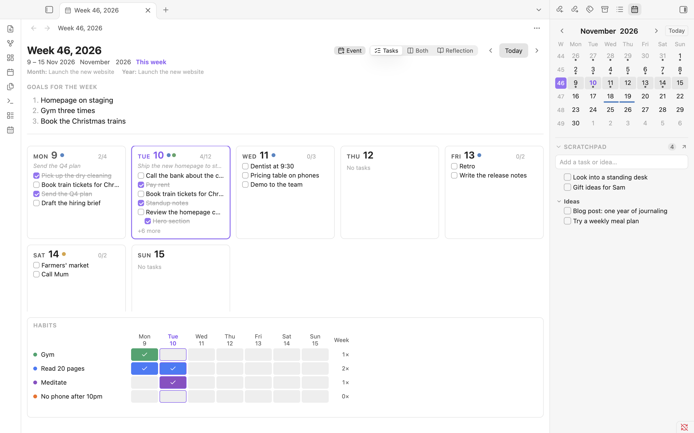
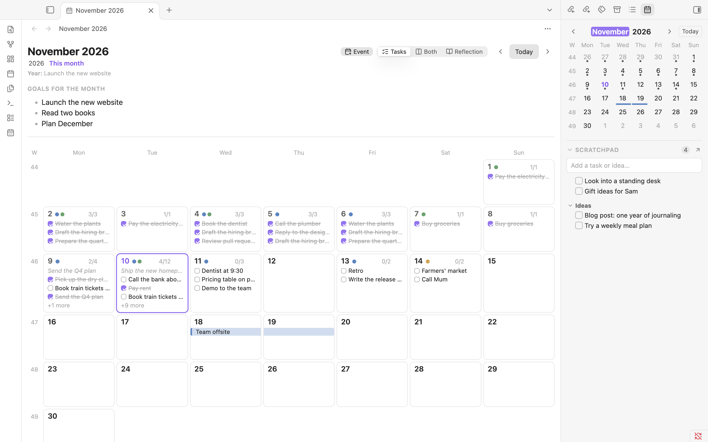
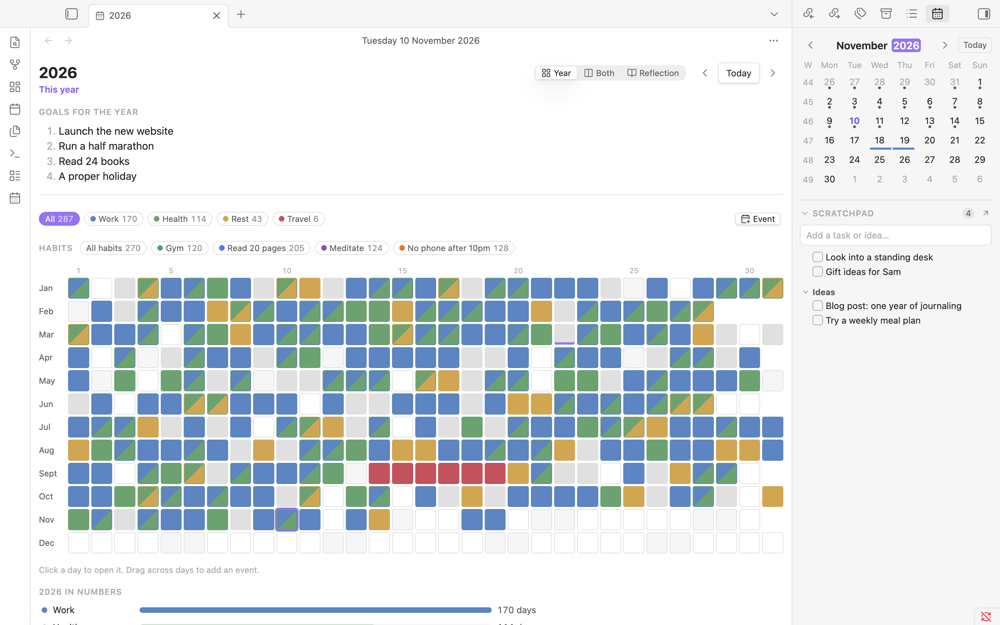

# Daybook

Plan your year, write your day, review your trips: tasks, goals and a diary in one calendar.



## Features

- **A calendar and four zoom levels.** A calendar in the right sidebar opens any day, week, month or year. Each has its own page, and you can step forward and back with ‹ Today ›.
- **A day page for tasks, goals, tags and a diary.** Goals at the top, task cards on the left, the diary on the right, and a notes scratchpad below. Switch between Tasks, Both and Diary, and paste or drop images into the diary.
- **Task cards.** Group tasks into cards like "Work" or "Home", nest them with Tab, drag them between cards, and expand one card to fill the page.
- **Week and month overviews you can edit in place.** Each day is a small card with its first tasks. Click one to add or tick tasks without leaving the overview. Weeks, months and years have their own goals and a reflection box.
- **A year at a glance.** Every day as a box, coloured by category (Work, Health, Travel or your own), with a legend to highlight one category.
- **Multi-day and repeating events.** Drag across days to add a trip or a conference. Events can repeat every week, month or year, and show in every view.
- **Recurring tasks.** "Pay rent, every month on the 1st." They appear on the days they're due, can end on a date, and can be paused or stopped from the task itself. A day that a month doesn't have (the 31st, 29 February) falls on its last day.
- **Carry-over and move to date.** Review yesterday's unfinished tasks and bring the ones you want into today, or move any task to another date. The old day shows where it went.
- **Projects with milestones.** A project stays on your day pages until it's finished, with a milestone checklist, a progress bar and its own task cards. A milestone can tick itself when its card is done.
- **Focus mode.** One day, only your open tasks and the diary, with no sidebars.





## How it's stored

Everything is plain Markdown in a `Daybook` folder in your vault (you can change the folder in settings):

```
Daybook/
├── 2026/
│   ├── 2026.md                 year: goals, reflection
│   ├── 11/
│   │   ├── 2026-11.md          month: goals, reflection
│   │   └── 2026-11-09.md       day: tags, goals, tasks, diary, notes
│   └── Weeks/
│       └── 2026-W46.md         week: goals, reflection
├── Projects/
│   └── Website.md              project: status, dates, milestones
├── Events/
│   └── Germany.md              event: start, end, category, repeats
└── Recurring.md                recurring tasks, one per line
```

A day note looks like this:

```markdown
---
tags:
  - work
---

## Goals

1. Finish the report

## Tasks

- [ ] Call the bank

### Work

- [x] Draft the report
- [ ] Send it to Sam

## Diary

A good day.
```

Notes are only created when you first type something, never just by opening a day. Daybook only changes the parts it manages (the `tags` property and its own sections). Anything else you write in a note is left as it is.

## Install

**From Obsidian.** Open **Settings → Community plugins → Browse**, search for **Daybook**, then select **Install** and **Enable**. Open it with the calendar icon in the left ribbon, or run **Daybook: Open today** from the command palette.

**By hand.** Download `main.js`, `manifest.json` and `styles.css` from the [latest release](https://github.com/patilsaurabhd/daybook/releases/latest) and put them in `<your vault>/.obsidian/plugins/daybook/`. Then reload Obsidian and enable Daybook under **Settings → Community plugins**.

Run **Daybook: How to use** from the command palette for a short guide.

## How it differs from Calendar, Periodic Notes and similar plugins

Calendar and Periodic Notes open and create daily, weekly and monthly notes from your own templates, and leave what goes inside them to you. That's flexible, and it works with any note layout. Daybook is more opinionated. It keeps its own simple note format and gives you pages built for it: task cards, goals at every level, week, month and year overviews you can edit in place, events, recurring tasks and carry-over. The trade-off is that it works with its own folder and notes, not your existing daily-note templates, and it isn't a task manager for your whole vault. It only sees tasks in its own day notes, unlike plugins such as Tasks.

## Privacy

Daybook makes no network requests and collects no data. Everything stays in your vault as Markdown: day, week, month and year notes, projects, events and recurring tasks. Images you paste go wherever Obsidian's attachment setting says. The plugin's own settings are stored in its `data.json` file.

## Development

```bash
npm install
npm run dev     # rebuild main.js on every change
npm run build   # type-check and production build
npm test        # tests for the planner logic in src/core
npm run lint
scripts/install-to-vault.sh "/path/to/Test Vault"
```

The planner logic in `src/core` has no Obsidian imports and is covered by the tests. Vault reading and writing is in `src/obsidian`, and the views are in `src/ui`.

## Licence

MIT
